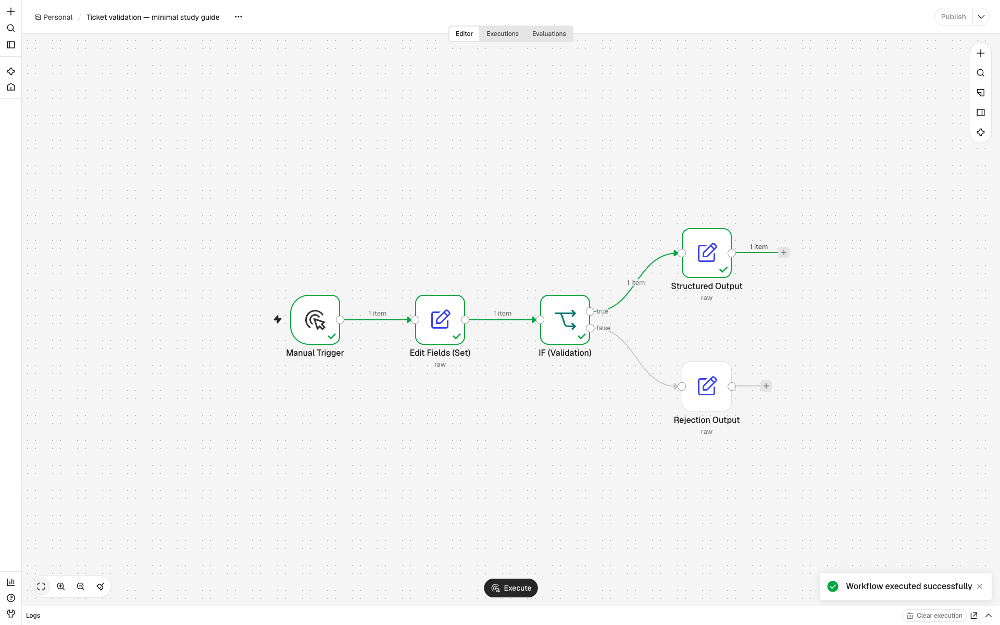
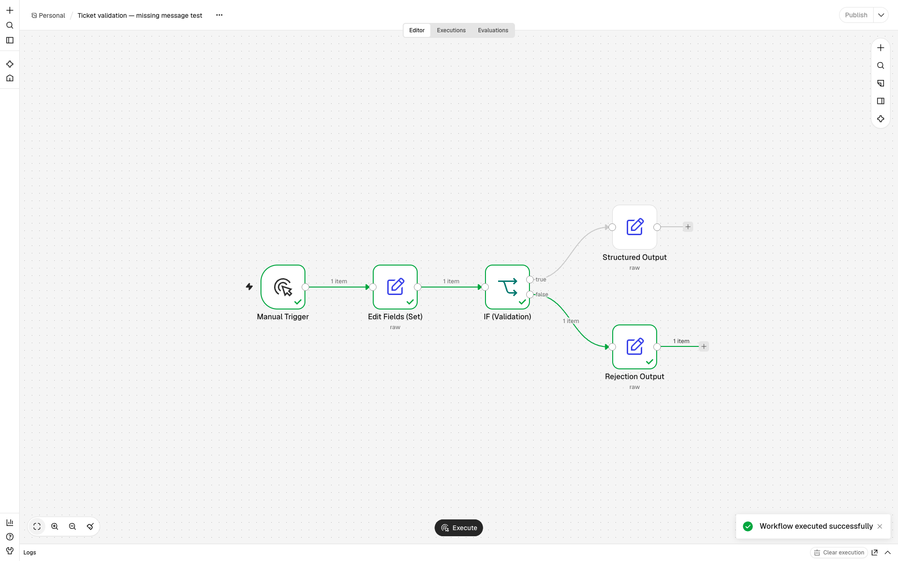
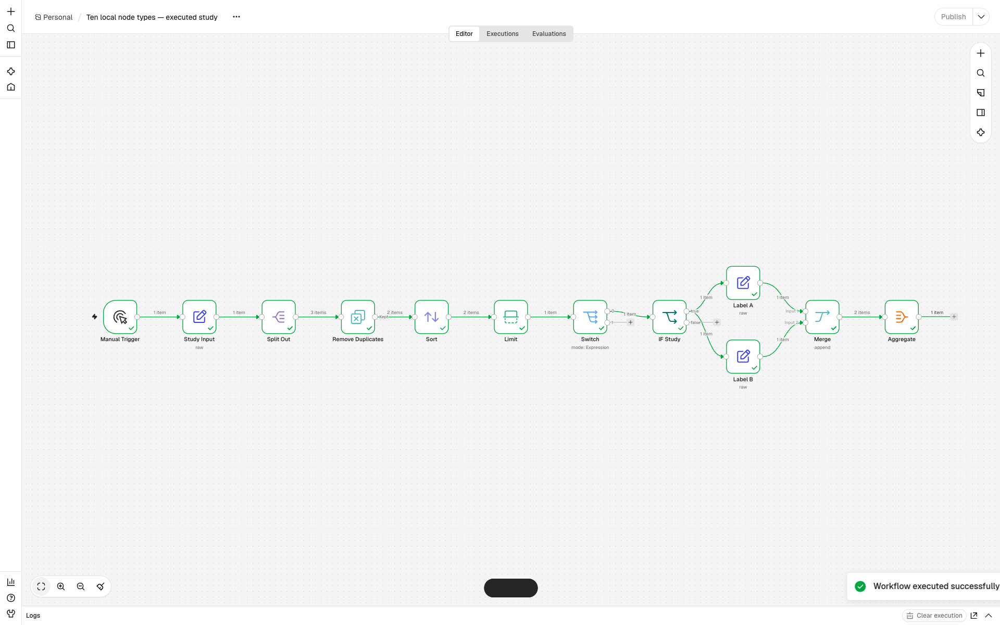

# Lab proof — reviewer entry point

Start here to review the n8n Node Study Guide lab. Original README, instructions, and rubric are preserved.

## Scope and evidence boundary

The ticket workflow was executed successfully in a real local n8n instance. All 10 local study node types were executed and tested. The PDF RAG and AI-chat template configurations were downloaded and inspected. Those two workflows were **not executed** because their required external API credentials were unavailable. There are no claimed RAG retrieval results, model answers, SerpAPI calls, or external-service execution traces. This limitation was explicitly accepted by the author for submission.

## Submission files

- [workflow.json](workflow.json): importable five-node ticket workflow.
- [node_reference.md](node_reference.md): 10 executed node types, actual JSON input/output examples, parameters, settings, and transformations.
- [sample_input.json](sample_input.json) and [sample_output.json](sample_output.json): configured ticket and actual accepted output.
- [study/local_nodes.json](study/local_nodes.json): separate workflow exercising ten distinct node types.
- [Three-workflow analysis](study/workflow_analysis.md): observed template configurations and limitations.
- [Official sources](study/official_sources.md): n8n documentation checked.
- [Evidence directory](evidence/): actual CLI traces and editor screenshots.
- [verify_evidence.py](verify_evidence.py): verifies recorded evidence without simulating n8n.

## Runtime and reproduction

Actual environment: n8n **2.45.7**, Node.js **v24.22.2**, macOS arm64. Node’s official download checksum was verified before use. Runtime dependencies, SQLite database, generated keys, browser session, and disposable local account stay outside this repository. The browser screenshots come from the actual local editor, not diagrams or reconstructed trace images.

With a compatible Node.js runtime, reproduce in a temporary n8n installation or import the workflow exports into your own instance. For CLI execution, use the pinned version; the tested CLI requires import first, then execution by workflow ID:

```sh
npm install --prefix /tmp/n8n-study-runtime n8n@2.45.7
export N8N_USER_FOLDER=/tmp/n8n-study-user
export N8N_DIAGNOSTICS_ENABLED=false
export N8N_LOG_LEVEL=info
/tmp/n8n-study-runtime/node_modules/.bin/n8n import:workflow --input=workflow.json
/tmp/n8n-study-runtime/node_modules/.bin/n8n execute --id=TicketLabValid001 --rawOutput
/tmp/n8n-study-runtime/node_modules/.bin/n8n import:workflow --input=study/local_nodes.json
/tmp/n8n-study-runtime/node_modules/.bin/n8n execute --id=NodeStudyLocal001 --rawOutput
python3 verify_evidence.py
```

To reproduce the rejection, duplicate the ticket workflow, remove message from the fixture Set JSON, and execute it. Only fixture/name/ID differ in the rejection test; the validation expression and routing are unchanged. No API credentials are needed for these local workflows.

The editor can be started with `n8n start` from the same installation and N8N_USER_FOLDER. Import/open the workflow, select Execute, then open each node to inspect Parameters, Settings, input JSON, and output JSON. The editor runs below localhost; no workflow was published or exposed publicly.

Runtime notes: the engine warned that its Python runner environment was missing and that internal runner/non-container installation modes are deprecated. No Python/Code nodes are used. The three recorded CLI executions finished with success and exit code 0. Initial sandbox initialization could not complete; execution succeeded after allowing local engine subprocesses. These setup issues are not treated as successful workflow runs.

## Ticket mapping and routing

```text
Manual Trigger → Edit Fields (Set) → IF (Validation)
                                      ├─ true → Structured Output
                                      └─ false → Rejection Output
```

Manual Trigger emits one empty JSON item. Set creates the supplied fixture, so this is a manual test input rather than a live event receiver. IF uses strict Boolean validation: ticket_id is a string matching T-<digits>; category is portal/monster/psychic/environmental; message is a nonblank string; priority is low/medium/high. Its true output is index 0, false output index 1. The output nodes are both Edit Fields nodes, not an AI Structured Output Parser.

Structured Output preserves the four input fields and adds status=accepted and queue=<category>-support. Rejection Output returns ticket_id (or null), status=rejected, and an explicit validation reason. The terminal node output is the destination artifact; it is not written to an external ticket system. Accepted means validation passed, not that the portal problem was solved.

## Actual execution: Successful ticket

Engine status: `success`; finished: `True`. Started 2026-11-02T00:09:46.676000+02:00 (Asia/Jerusalem). The source timestamps remain in UTC in the JSON.

Executed node sequence: `Manual Trigger → Edit Fields (Set) → IF (Validation) → Structured Output`.

Exact trace: [valid-execution.json](evidence/valid-execution.json). Captured command/output/exit status: [valid-execution.txt](evidence/valid-execution.txt). Only the generated resume token was redacted; node payloads, statuses, timing, source links, and pairing metadata were preserved.

Actual final output:

```json
[
  {
    "ticket_id": "T-001",
    "category": "portal",
    "message": "The portal opens at unpredictable times",
    "priority": "high",
    "status": "accepted",
    "queue": "portal-support"
  }
]
```

Actual configured input:

```json
{
  "ticket_id": "T-001",
  "category": "portal",
  "message": "The portal opens at unpredictable times",
  "priority": "high"
}
```

IF output 0 contains exactly that ticket; output 1 is empty. Rejection Output did not execute.



[IF parameters and JSON input/output](evidence/ticket-if-validation-parameters.png) · [IF Settings](evidence/ticket-if-validation-settings.png) · [Final output panel](evidence/ticket-structured-output-parameters.png)

## Actual execution: Rejected ticket

Engine status: `success`; finished: `True`. Started 2026-11-02T00:09:52.824000+02:00 (Asia/Jerusalem). The source timestamps remain in UTC in the JSON.

Executed node sequence: `Manual Trigger → Edit Fields (Set) → IF (Validation) → Rejection Output`.

Exact trace: [invalid-execution.json](evidence/invalid-execution.json). Captured command/output/exit status: [invalid-execution.txt](evidence/invalid-execution.txt). Only the generated resume token was redacted; node payloads, statuses, timing, source links, and pairing metadata were preserved.

Actual final output:

```json
[
  {
    "ticket_id": "T-001",
    "status": "rejected",
    "reason": "Require T-<digits> ticket_id, supported category, nonblank message, and low/medium/high priority."
  }
]
```

Actual invalid input:

```json
{
  "ticket_id": "T-001",
  "category": "portal",
  "priority": "high"
}
```

IF output 0 is empty; output 1 contains the missing-message ticket. Structured Output did not execute. Rejected is a business decision; the workflow itself successfully ran.



[Rejection parameters and JSON input/output](evidence/rejected-rejection-output-parameters.png)

## Actual execution: Ten-node study

Engine status: `success`; finished: `True`. Started 2026-11-02T00:09:50.265000+02:00 (Asia/Jerusalem). The source timestamps remain in UTC in the JSON.

Executed node sequence: `Manual Trigger → Study Input → Split Out → Remove Duplicates → Sort → Limit → Switch → IF Study → Label A → Label B → Merge → Aggregate`.

Exact trace: [nodes-execution.json](evidence/nodes-execution.json). Captured command/output/exit status: [nodes-execution.txt](evidence/nodes-execution.txt). Only the generated resume token was redacted; node payloads, statuses, timing, source links, and pairing metadata were preserved.

Actual final output:

```json
[
  {
    "records": [
      {
        "ticket_id": "T-001",
        "rank": 1,
        "label": "A"
      },
      {
        "ticket_id": "T-001",
        "rank": 1,
        "label": "B"
      }
    ]
  }
]
```

The 10 distinct types are Manual Trigger, Edit Fields, IF, Split Out, Remove Duplicates, Sort, Limit, Switch, Merge, and Aggregate. Multiple Set instances count as one type. Split Out emits 3 items, deduplication retains 2, Sort orders ranks 1 then 2, Limit keeps T-001, Switch and IF route it, the two Set branches label A/B, Merge appends both items, and Aggregate wraps them under records.



Each reference-table row links its real Parameters/data and Settings screenshots. Exact upstream inputs can also be followed through the trace’s source.previousNode / previousNodeOutput links.

## Three workflow risks

1. **Missing or incorrectly mapped fields:** expressions can read the wrong path or receive null/wrong types. Guarded validation rejects the missing-message example, but arbitrary malformed inputs were not exhaustively tested.
2. **Incorrect routing or field loss:** reversed IF outputs or output mappings can reject good tickets or omit fields. Inspect branch item counts and compare final records against the original ticket.
3. **Duplicates and destination reliability in daily operation:** reruns can duplicate downstream work if a real destination is later added. The ticket path has no durable deduplication or delivery acknowledgment. The separate study deduplication applies only to its current fixture, not across daily ticket executions.

## Two trace checks

1. Follow Set output into IF input using predecessor links and compare all four fields, including types. Confirm true/false branch arrays and that only the selected output node ran.
2. Match the terminal node JSON to sample_output.json (or invalid_output.json), verify status/finished and successful node statuses, and inspect the recorded source links for each transformation. A green success indicator alone does not establish correct mappings.

## One simplification

Keep the ticket workflow to five nodes with explicit mappings. Study additional node types in a separate local exercise; omit models, paid APIs, and external ticket storage from the critical proof path.

## Actual verification

Command: `python3 verify_evidence.py`

```text
PASS: 3 real n8n traces, both IF routes, exact input/output mapping, 10 executed node types, study transformations, and predecessor links.
```

This is a recorded-evidence verifier, not a replacement n8n engine and not a claim that pytest ran. The real workflow execution evidence is the n8n CLI output plus live editor screenshots.

## Mandatory requirement review

| Requirement | Status / evidence |
| --- | --- |
| Read README, instructions, rubric | Inspected; original files preserved. |
| Working n8n instance / setup check | Real local editor plus successful Manual Trigger/Set execution in both workflows. |
| Access three workflows | Two named official templates downloaded/inspected; local ticket workflow created. Class exports were not supplied. |
| Analyze 10 different node types | Ten local types executed, with a comprehensive node table and actual per-node payloads. |
| Parameters and settings | Exact workflow JSON and real Parameters/Settings screenshots linked per node. |
| JSON inputs, outputs, transformations | Actual examples and source links in node_reference.md and execution JSON. |
| Configuration/input/output screenshots | Local-node panels and canvas screenshots in evidence; template screenshots are configuration-only. |
| Execution of RAG/AI-chat service nodes | Not completed: external credentials unavailable. Configuration/documentation analysis only; limitation accepted by author. |
| Workflow export, input, output, trace | workflow.json, sample_input.json, sample_output.json, evidence files. |
| Risks/checks/simplification | Three risks, two trace checks, one simplification above. |
| Explain first daily failure to monitor | Author’s reflection below identifies missing/mapped fields. |
| Reviewer entry point | This lab_proof.md links all deliverables. |
| Submission hygiene | Only lab files and synthetic fixtures; runtime, keys, credentials, and caches excluded. |

## Personal reflection — supplied by author; review before final acceptance

The hardest part for me was understanding how data moves between nodes, especially how the IF node evaluates fields from the previous node and routes the data to different outputs. I also had to understand how JSON expressions reference the correct fields.

If this workflow ran daily, the first failure I would monitor would be missing or incorrectly mapped input fields. These could cause valid requests to be rejected or produce incomplete output records. I would monitor execution errors and verify that the output contains all required fields.

This reflection was supplied by the author and is preserved for their review. No observations about unexecuted external-service workflows are attributed to the author.
