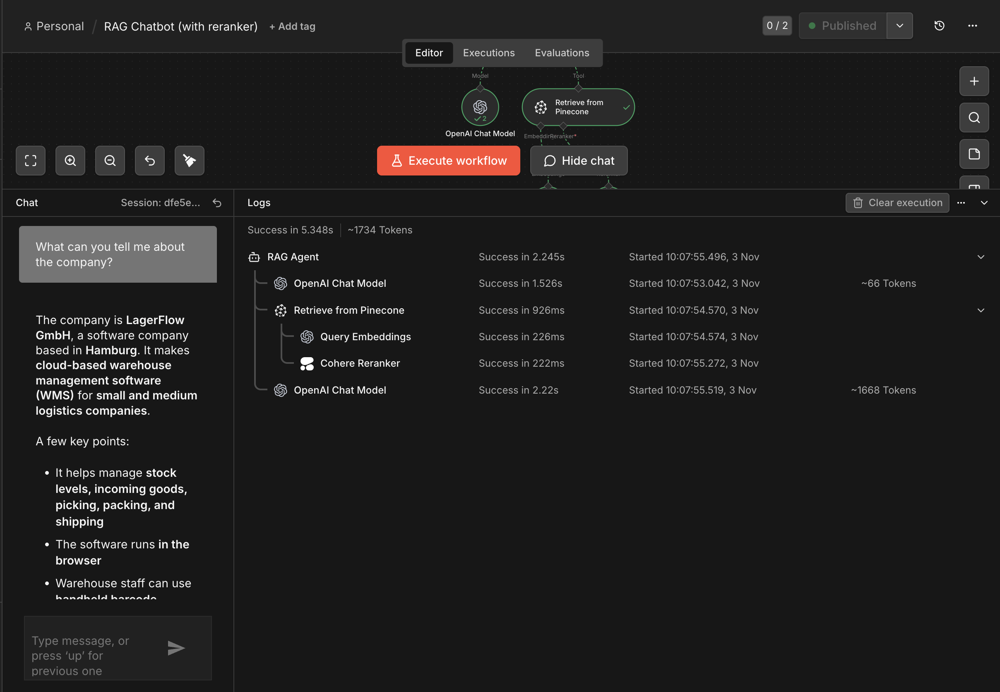
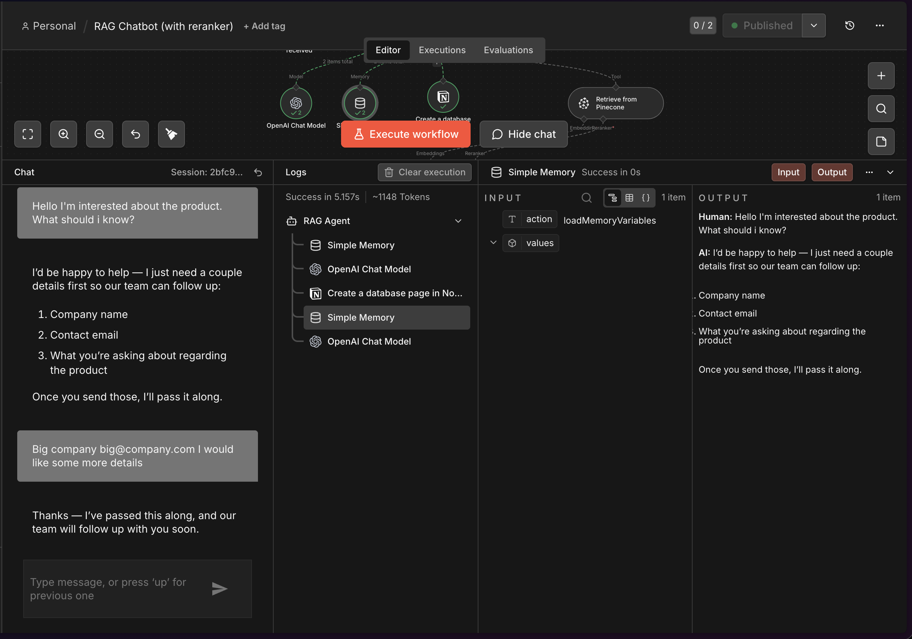
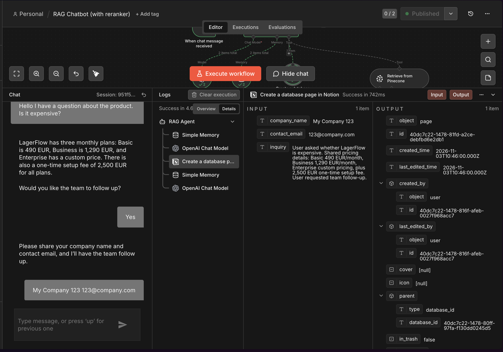
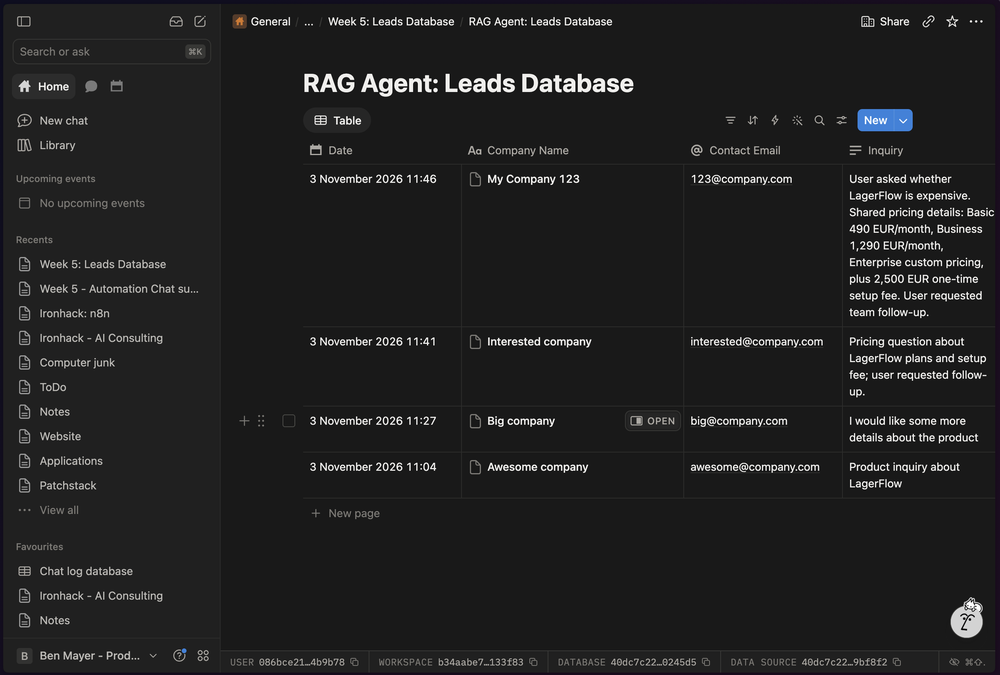

# Lab Proof: n8n Node Study Guide

**Workflow studied:** RAG Chatbot (with reranker) — OpenAI + Pinecone + Cohere, extended with memory and a Notion lead-capture tool
**Export:** [`workflow_export.json`](./workflow_export.json) (credentials, webhook IDs and Notion database ID removed)
**Source document used for the knowledge base:** [`LagerFlow_Product_FAQ.pdf`](./LagerFlow_Product_FAQ.pdf) (fictional company, training data)

## How the workflow works (two paths)

```text
INGEST: Upload Documents Form -> Store in Pinecone
          sub-nodes: Document Loader (+ Text Splitter), OpenAI Embeddings

QUERY:  When chat message received -> RAG Agent
          sub-nodes: OpenAI Chat Model, Simple Memory,
                     Retrieve from Pinecone (tool) -> Query Embeddings, Cohere Reranker,
                     Create a database page in Notion (tool, lead capture)
```

**Extension added after the first run:** a lead-capture path. The agent keeps conversation memory (Simple Memory). After it answers a pricing or product question it asks whether the team should follow up. Only if the user says yes does it collect company name and email and save a lead in Notion.

Sub-nodes connect through typed ports (`ai_embedding`, `ai_document`, `ai_textSplitter`, `ai_languageModel`, `ai_memory`, `ai_tool`, `ai_reranker`), not `main`. Only trigger -> root node uses `main`.

## Node Reference Table

Parameters, settings and JSON columns come from the real workflow and from executions 925 (ingest), 926 (first chat run), 1049, and 1124–1126 (final lead-capture flow).

| Node | Parameters | Settings | What It Does | JSON Input | JSON Output | Key Transformations |
|------|------------|----------|--------------|------------|-------------|---------------------|
| Form Trigger (`formTrigger` v2.5) | Title, description, 1 file field `documents` (accepts .pdf/.csv/.json) | Append attribution: off | Starts the ingest path. Serves a web form; when someone uploads a file, it fires the workflow with the file attached. | none (trigger) | `{documents:[{filename, mimetype, size}], submittedAt, formMode}` + binary `documents` (PDF) | HTTP file upload -> n8n item. The file itself moves into `binary.documents`; only its description stays in `json`. |
| Document Loader (`documentDefaultDataLoader` v1.1) | Data type: Binary; Text splitting: Custom (uses attached splitter) | Options: none | Reads the uploaded file's binary data, extracts the text, and wraps it as LangChain "Documents" (text + metadata). Hands the text to the splitter first. | the binary PDF | `{response:[{pageContent, metadata:{source, blobType, pdf info, loc.lines}}]}` | Binary PDF -> plain text in `pageContent`, plus metadata (PDF info, source, and line range `loc.lines` per chunk). |
| Recursive Character Text Splitter (v1) | none set (defaults) | — | Cuts long text into smaller chunks, trying to break at paragraph, then line, then word boundaries. Small chunks make retrieval precise and fit the embedding model. | document text | `{response:[ "chunk 1…", "chunk 2…", … ]}` (3 chunks for this PDF) | One long string -> array of shorter strings. The text itself is not changed, only cut. |
| OpenAI Embeddings (`embeddingsOpenAi` v1.2) | Options: Dimensions = 512 | Credential: OpenAI API | Turns text into a vector of numbers that captures its meaning, so similar texts end up close together. Used at ingest (chunks) and at query time (question); both must use the same model and dimensions. | chunk text | `{response:[ 512 floats ]}` | Text -> 512 numbers. One-way: you cannot get the text back from the vector, so Pinecone also stores the text next to it. |
| Pinecone Vector Store, insert (v1.3) | Mode: Insert; Index: `lagerflow-faq` | Credential: Pinecone API | Writes each chunk's vector plus its text and metadata into the Pinecone index. Insert mode always adds new records, so uploading the same file twice stores it twice. | 3 documents + embeddings (via sub-ports) | 3 items, one per stored chunk: `{pageContent, metadata}` | Chunk + vector -> stored record with a new random ID. The node's output is the documents, not the vectors. |
| Chat Trigger (`chatTrigger` v1.4) | Public: true; Initial message: "Hi there! How can i help you today." | — | Starts the query path. Hosts a public chat window; each message fires the workflow with the text and a session ID. | none (trigger) | `{action:"sendMessage", sessionId, chatInput}` | Chat message -> n8n item. `sessionId` is what ties separate messages into one conversation for memory. |
| AI Agent (`agent` v3.1) | System message (final version): answer ONLY from retrieved context; for pricing/product questions answer first, then ask if the team should follow up; only after a "yes" collect company name + email and call the Notion tool once with a conversation summary as the inquiry; never guess; streaming on | — | The orchestrator. Runs a loop: ask the model, let it call tools (search the docs, save a lead), feed results back, repeat until it has a final answer. Which tool to call is the model's decision, guided by the system prompt and tool descriptions. | `chatInput` from trigger | `{output: "<answer text>"}` | Message + history + tool list -> prompt; tool results -> final text. Many internal steps collapse into a single `output` string. |
| OpenAI Chat Model (`lmChatOpenAi` v1.3) | Model: `gpt-5.4-mini` | Credential: OpenAI API | The "brain" the agent calls. It reads the conversation and either answers or asks for a tool call. | prompt/messages from agent | `generations[].text` + `tokenUsageEstimate` | Messages -> text, or a tool call (shown as an empty `text`). Runs twice in a tool turn: once to decide, once to write the final answer. |
| Pinecone Vector Store, retrieve-as-tool (v1.3) | Mode: Retrieve as Tool; tool description; Index `lagerflow-faq`; Top K = 5; Use Reranker: on | Credential: Pinecone API | Gives the agent a "search the documents" tool. Embeds the agent's query, finds the Top K nearest chunks in Pinecone, passes them through the reranker, and returns them to the agent. | agent's search query | `response: [ {type:"text", text:"{pageContent, metadata, id}"} ]` (3 hits) | Query string -> embedding -> nearest chunks. Each hit comes back as a JSON *string* inside `text`, so it is readable by the model, but not structured for downstream n8n nodes. |
| Cohere Reranker (`rerankerCohere` v1) | none set; defaults: model `rerank-v3.5`, **Top N = 3** | Credential: Cohere API | Second-pass ranking. Vector search is fast but approximate; the reranker reads the query and each candidate together and scores how relevant each one is, then reorders them. | candidate docs from Pinecone | same docs + `metadata.relevanceScore` (e.g. 0.052, 0.024, 0.019 in exec 1124) | Adds a `relevanceScore` to each doc, sorts by it, and cuts the list to Top N (3). |
| Simple Memory (`memoryBufferWindow` v1.3) | none set (defaults) | — | Gives the agent a short-term memory. Stores recent messages per session ID and loads them before each model call, so the chat model can see what was said earlier. | session history, keyed by `sessionId` | `{action:"loadMemoryVariables", chatHistory:[HumanMessage/AIMessage/ToolMessage…]}` | Session ID -> list of earlier messages (including old tool results), which are added to the prompt on every call. |
| Notion Tool (`notionTool` v2.2) — "Create a database page in Notion" | Resource: Database Page; Database ID (by ID); Title = `$fromAI('company_name')`; properties: Contact Email (email) = `$fromAI('contact_email')`, Inquiry (rich text) = `$fromAI('inquiry')`, Date = `$now.toISO()` | Credential: Notion API; Simple output: off | Gives the agent a "save a lead" tool. The model fills the fields (`$fromAI`), and n8n creates a new page (row) in the Notion Leads database. This is the one node in the workflow that changes something in an outside system. | `{company_name, contact_email, inquiry}` filled in by the model via `$fromAI` | full Notion page object (`properties.Company Name / Contact Email / Inquiry / Date`, `parent.database_id`, `url`) | Free-text conversation -> three typed Notion fields (title, email, rich text), plus a timestamp from `$now`. The model decides the values; n8n only passes them on. |

That is **11 distinct node types** (9 from the original workflow + Simple Memory + Notion Tool), so the 10-type requirement is met.

Variations noted: `Pinecone Vector Store` is used twice with different modes (insert vs retrieve-as-tool); `OpenAI Embeddings` is used twice (named "OpenAI Embeddings" and "Query Embeddings"), both with 512 dimensions.
**Why the two must match:** similarity search compares vectors, which only makes sense if both were made by the same model at the same size. The Pinecone index also has a fixed dimension set when it was created, so a vector of a different size would be rejected (or, if the model differed, would compare meaningless numbers).

## Execution trace (first chat path, execution 926, status: success, 4.7 s)

| Step | Node | Time | Items out |
|---|---|---|---|
| 1 | When chat message received | 1 ms | 1 |
| 2 | OpenAI Chat Model (decide tool call) | ~1.5 s | 1 |
| 3 | Retrieve from Pinecone | 926 ms | 1 (3 docs) |
| 3a | Query Embeddings | 226 ms | 1 (512 floats) |
| 3b | Cohere Reranker | 222 ms | 1 (3 docs) |
| 4 | OpenAI Chat Model (write answer) | ~2.2 s | 1 |
| 5 | RAG Agent | 2.2 s | 1 |

Ingest path: execution 925, success, 2.3 s. Form -> Document Loader -> Text Splitter -> OpenAI Embeddings -> Store in Pinecone (3 items).

Screenshot of the chat run: 

### Input payload (execution 926)

```json
{
  "action": "sendMessage",
  "sessionId": "dfe5e8a1ac9a457d863595a7fb6b49e1",
  "chatInput": "What can you tell me about the company? "
}
```

### Output record (execution 926, RAG Agent)

```json
{
  "output": "The company is **LagerFlow GmbH**, a software company based in **Hamburg**. It makes **cloud-based warehouse management software (WMS)** for **small and medium logistics companies**.\n\nA few key points:\n- It helps manage **stock levels, incoming goods, picking, packing, and shipping**\n- The software runs **in the browser**\n- Warehouse staff can use **handheld barcode scanners**\n- It is aimed at companies with **20 to 500 employees** and **1 to 10 warehouses**\n- It offers plans starting at **490 EUR/month**, plus a **2,500 EUR one-time setup fee**\n- The software is available in **German, English, Polish, and Turkish**\n\nSources used:\n- **LagerFlow – Product FAQ**"
}
```

## Lead capture: how the prompt evolved

The Notion tool was added after the first run. Getting the agent to use it at the right moment took three versions of the system prompt. The workflow nodes did not change; only the prompt did.

| Version | Rule in the prompt | Result |
|---|---|---|
| v1 | "If the user asks about pricing or the product, collect company, email, inquiry, then call the Notion tool." (written as an *exception* to answer-from-docs) | Worked in exec 1049 (user volunteered everything), but see v1 failure below. |
| v2 | "Always search the docs first; never ask for contact details before answering; 'more details' is not a follow-up request." (an interim fix, replaced by v3) | Superseded by v3, which adds an explicit confirmation step. |
| v3 (final) | "Answer first, then ask whether the team should follow up. Only if the user confirms, collect company name and email. Put a conversation summary in the Inquiry field." | Works: see the run below (execs 1124–1126). |

### Failure case: lead capture hijacked the answer (v1 prompt, executions 1108 and 1109)

Screenshot: 

| Turn | User message | What the agent did | What it should have done |
|---|---|---|---|
| 1 (exec 1108) | "Hello I'm interested about the product. What should i know?" | Asked for company name, email, and inquiry. **Never searched the documents.** | Search Pinecone, answer from the FAQ, then offer a follow-up. |
| 2 (exec 1109) | "Big company big@company.com I would like some more details" | Called the Notion tool and replied "Thanks, I've passed this along." **Still no retrieval, no answer.** | Answer the request for more details from the docs. |

The Notion row saved by turn 2 was Company Name "Big company", Contact Email "big@company.com", Inquiry "I would like some more details about the product". It is a valid row, but the user's actual question was never answered, and the "inquiry" is just the user's own words, with no real follow-up request behind it.

**Root cause (prompt, not code):** the v1 prompt said "if the user asks about pricing or about the product, collect these three details… call the Notion tool", and framed it as an exception to the answer-from-docs rule. A product question matched the exception first, so the model took the most specific, action-oriented instruction. n8n does not check the order of tool calls; the model decides.

### Final flow: answer first, follow up only on request (v3 prompt, session `951f5300…`, executions 1124–1126)

Screenshot: 

| Turn | Execution | User message | Agent behaviour |
|---|---|---|---|
| 1 | 1124 (5.4 s) | "Hello I have a question about the product. Is it expensive?" | **Searched Pinecone** (Retrieve 1.38 s, Cohere 0.21 s), answered: 3 plans (490 EUR, 1,290 EUR, custom) plus a 2,500 EUR one-time setup fee, then asked "Would you like the team to follow up?" No Notion call. |
| 2 | 1125 (1.8 s) | "Yes" | No tools. Asked for company name and contact email. |
| 3 | 1126 (4.0 s) | "My Company 123 / 123@company.com" | Called the Notion tool once (742 ms), then confirmed "Thanks — the team will follow up with you soon." |

**Input payload (turn 3, chat trigger, exec 1126):**
```json
{
  "action": "sendMessage",
  "sessionId": "951f5300ea574067bd6568e20dd76220",
  "chatInput": "My Company 123\n123@company.com"
}
```

**Tool input (what the model put into the `$fromAI` slots):**
```json
{
  "company_name": "My Company 123",
  "contact_email": "123@company.com",
  "inquiry": "User asked whether LagerFlow is expensive. Shared pricing details: Basic 490 EUR/month, Business 1,290 EUR/month, Enterprise custom pricing, plus 2,500 EUR one-time setup fee. User requested team follow-up."
}
```

**Notion node output (trimmed):**
```json
{
  "object": "page",
  "parent": { "type": "database_id" },
  "properties": {
    "Company Name":  { "type": "title",     "title": [{ "plain_text": "My Company 123" }] },
    "Contact Email": { "type": "email",     "email": "123@company.com" },
    "Inquiry ":      { "type": "rich_text", "rich_text": [{ "plain_text": "User asked whether LagerFlow is expensive. Shared pricing details: …" }] },
    "Date":          { "type": "date",      "date": { "start": "2026-11-03T11:46:00.000+01:00" } }
  }
}
```

**Output record (RAG Agent, exec 1126):**
```json
{ "output": "Thanks — the team will follow up with you soon." }
```

**Verify (reviewer):** the observable output is the new row "My Company 123" in the Notion Leads database. The other rows are earlier tests, and show how the saved Inquiry improved across prompt versions: "Product inquiry about LagerFlow" (v1) -> "I would like some more details about the product" (the failure) -> a real conversation summary (v3).



**How the three fields got filled:** the model infers the `$fromAI(...)` values from memory plus the new message. The company name and email come from turn 3; the inquiry summary comes from turn 1, which is only possible because Simple Memory replays it. In exec 1126 the first model call used 1,737 prompt tokens (history + tools) and the second, after the tool result, 2,540.

## Observations

- **Duplicate chunks (found, confirmed, fixed).** In the first runs, Retrieve from Pinecone returned two chunks with identical `pageContent` but different `id`s. Confirmed in Pinecone: the document had been uploaded twice. Insert mode gives every chunk a new ID and nothing deduplicates, so a second upload stores a second copy. Duplicates waste Top K slots and can crowd out other relevant chunks. **Fix:** deleted all records, re-uploaded the PDF once (exec 1103: success, 3 chunks stored). **Result:** in exec 1124 the three returned chunks are all different (lines 1–16, 17–30, 31–39).
- **Low rerank scores.** The best score was 0.114 for "tell me about the company" (exec 926) and 0.052 for "Is it expensive?" (exec 1124). Scores only make sense as a ranking *within one query*, not as an absolute pass mark. They are probably low here because each chunk bundles several FAQ answers, so no chunk is a tight match for a short, vague question. In exec 1124 the chunk that contains the pricing answer (FAQ question 3) was still ranked first, so ranking worked.
- **Top K = 5 but 3 docs came back.** The Cohere Reranker node has **Top N = 3** by default (checked in the node's documentation), and it cuts the list after reranking. Top K is how many candidates Pinecone fetches; Top N is how many survive. With only 3 chunks in the index after the cleanup, 3 is also the maximum available.
- **Memory side effect.** Memory replays old messages, including whole Pinecone results, into every prompt, so each turn costs more tokens and takes longer than the last. In exec 1126 the second model call used 2,540 prompt tokens for a one-line reply. For a long conversation this is a cost and latency risk; limiting the number of remembered messages or not storing tool results would reduce it.
- **Misleading citation (resolved by changing the prompt).** In v1, exec 1049 ended with "Document used: LagerFlow Product FAQ" although no retrieval had run in that turn: the "always cite" rule made the model cite from earlier turns. The final prompt no longer asks for citations, and the answers in execs 1124 and 1126 have none. That fixes the false claim but loses the source reference; a better fix is to cite only when a retrieval ran in the current turn.
- **Brittle mapping.** The Notion property key is `Inquiry ` (with a trailing space), copied from the column name in Notion. If someone renames the column, the write will fail with a property error. Fix: rename the Notion column to `Inquiry` and update the key, or map by property ID.
- **A prompt, not code, enforces the rules** (answer first, ask before saving, call once, only with all details). Nothing in n8n blocks a bad call, as the v1 failure showed. A hard check would wrap the Notion write in a sub-workflow (via a "Call n8n Workflow" tool) that validates the fields (non-empty company, valid email format) and checks for an existing lead with the same email, and only then writes.

## Explain: first failure mode to monitor if this ran daily

I would watch two things. The **first** is the Notion write, because it is the only step that changes something outside n8n and the only one where a failure can go unnoticed.

### 1. Notion write failing silently, or creating duplicate/incomplete leads (monitor first)

**Why this is the riskiest step.** Every other node only reads or computes. The Notion node creates a permanent row, and the *model* decides when to call it and what to put in it. A bad run does not look like a crash; it looks like a normal chat.

**How it can go wrong in this workflow:**
- **Silent failure.** The RAG Agent's output is not connected to any error handling or notification (its `main` connection is empty). If the write fails, for example because someone renames the `Inquiry ` column (see the brittle-mapping observation), the only trace is in the execution log. The user may still be told the team will follow up, and the lead is lost.
- **Duplicates.** "Call the tool exactly once" is only an instruction in the prompt. Nothing checks for an existing lead, so a user who confirms twice, or a retried run, can create the same lead twice. This is the same class of problem as the double Pinecone upload I found earlier: insert operations are not idempotent.
- **Incomplete or wrong data.** The model fills `company_name`, `contact_email` and `inquiry` itself. Nothing validates them (for example `123@company` would be accepted). The v1 failure already showed the quality risk: a lead was saved with the inquiry "I would like some more details about the product".

**What I would monitor:**
- The status of the Notion node in every run that reached it.
- Once a day, compare the number of executions where the Notion node ran with the number of new rows in the Leads database. A mismatch means a lost or duplicated lead.
- A daily check for rows with an empty or malformed email, or the same email twice.

**Mitigations:** an n8n error workflow that sends an alert when the Notion step fails; wrapping the write in a sub-workflow that validates the fields and looks up the email before creating the row; fixing the property key to the exact column name.

### 2. API, credential and quota errors

**Why this matters.** The chat path depends on four external services: OpenAI (chat model and the embeddings), Pinecone, Cohere and Notion. If one credential expires or one quota runs out, the bot cannot answer, and nothing in the workflow degrades gracefully. Both Embeddings nodes and the chat model share **one OpenAI credential**, so a single exhausted quota or revoked key stops ingest and query at the same time.

**Evidence from this lab:** the first runs failed before the first success. For example, execution 924 failed in "Store in Pinecone" with `Index n8n not found` (the node pointed at the wrong index before it was set to `lagerflow-faq`). That is a configuration error, not a quota error, but it shows how a single external setting stops the whole path, and how clearly n8n reports the failing node.

**Specific risks:**
- **Quota / rate limits (HTTP 429).** The workflow gets more expensive over time: Simple Memory resends the full conversation, including old Pinecone results, on every model call (2,540 prompt tokens for a one-line reply in exec 1126). Free or trial tiers of these services usually have limits, so a busy day can hit them.
- **Expired or revoked keys.** API keys and the Notion connection can expire or be rotated without anyone touching the workflow, so the first sign is an error at the next run.
- **Provider outages and slow responses.** Each answer needs several sequential calls (model, embeddings, Pinecone, Cohere, model again), so any one slow call slows the whole reply, and any one failing call fails it.

**What I would monitor:**
- Execution status `error` and the failing node name, from an n8n error workflow that alerts me.
- A rise in execution time (a sign of throttling).
- Spend and quota dashboards at OpenAI, Cohere and Pinecone, with alerts at around 80%.

**Mitigations:** turn on "Retry on fail" with a delay for the nodes that call APIs; use separate credentials for ingest and chat, so that one quota cannot stop both; limit how much memory is replayed.